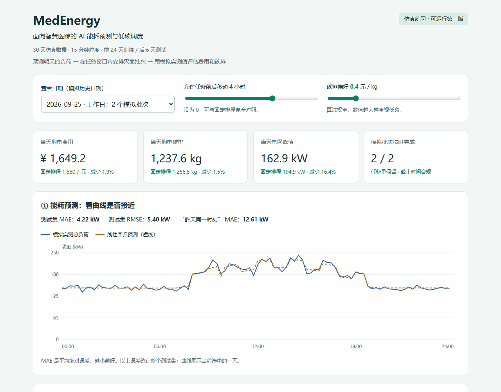
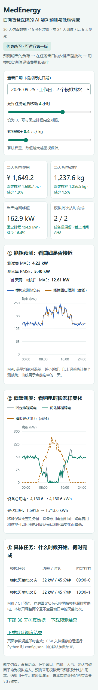

<div align="center">

# MedEnergy

### Energy Forecasting · Carbon-Aware Scheduling · Human Review

一个可运行、可交互的能源管理教学原型：预测负荷，在任务约束内安排可移动批次，并用模拟光伏、电价和碳因子比较情景结果。

[查看看板截图](assets/dashboard-desktop.png) · [查看模型与实验](#实验结果) · [运行项目](#快速体验)

</div>



<details>
<summary>查看移动端看板</summary>



</details>

> 这是学生学习原型。医院负荷、任务窗口、光伏、电价和碳因子均为仿真输入；它不接入真实医院，不控制设备，也不构成经审计的减排结论。

## 它解决什么问题

能源管理需要同时考虑“什么时候会用电”与“哪些工作可以安全地调整时间”。MedEnergy 用一条简单、可解释的流程展示这个问题：

```text
可提前获得的模拟特征
        ↓
负荷预测 → 任务可行窗口内枚举排程 → 费用 / 电网购电碳排回放
        ↓                           ↓
误差与基线对照              人工查看建议，不自动控制设备
```

## 演示内容

- 交互式看板：按日查看预测、负荷、光伏与固定/优化排程。
- 预测对照：线性回归与“昨天同一时刻”基线在留出的测试集上比较。
- 约束调度：只移动两个互不重叠窗口内的模拟批次；任务能量、时长和截止时间保持不变。
- 指标回放：用仿真的实际负荷和光伏评估预测方案，展示购电费用、购电碳排、峰值及光伏利用变化。
- 可复现输出：运行后生成 CSV 预测和排程，以及 JSON 评估报告。

## 实验结果

固定随机种子 `17`，使用 **24 天训练 + 6 天测试**，每 15 分钟一个时间点。以下数字来自仓库中的教学仿真：

| 指标 | 固定排程 | 可移动排程 | 变化 |
| --- | ---: | ---: | ---: |
| 测试集负荷预测 MAE | 昨天同一时刻基线：12.61 kW | 线性回归：4.22 kW | 该仿真测试集更低 |
| 购电费用 | ¥10,373.15 | ¥10,272.69 | -0.97% |
| 购电碳排 | 7,738.37 kg | 7,675.69 kg | -0.81% |
| 总设备用电量 | 25,540.07 kWh | 25,540.07 kWh | 相同 |
| 任务约束违反 | - | 0 | 8 个任务全部完成 |

费用与碳排是**仿真情景的回放结果**，不是实际医院节省或减排。排程只改变批次的时间位置；结果可能受时段、假设参数和仿真种子影响。

## 快速体验

下载仓库后，直接用浏览器打开 [`dashboard.html`](dashboard.html)，无需安装依赖或联网。GitHub 仓库页面不会直接运行这个 HTML 文件；线上预览请看上方截图。

需要重新生成预测和结果时，使用 Python 3.10+：

```bash
python medenergy.py
```

Windows 也可以双击 `run.cmd`。核心逻辑只使用 Python 标准库，不需要 `pip install`。

## 复现实验

1. 从 `config.json` 查看随机种子、训练天数、模拟光伏容量、任务窗口与目标权重。
2. 运行 `python medenergy.py`。
3. 在 `results/evaluation.json` 查看 MAE、基线、费用、碳排和约束检查。
4. 在 `results/predictions.csv` 与 `results/schedules.csv` 查看逐时段输出。
5. 打开更新后的 `dashboard.html` 交互查看不同日期和参数。

默认参数下记录的指标也保存在 `results/evaluation.json` 中。

## 模型与边界

- 特征仅包含模拟天气预报、计划占用率、固定影像负荷及时刻特征。
- 按时间先后切分数据，测试日不参与训练；另与朴素基线比较。
- 线性回归加入小幅岭惩罚，不使用深度学习。
- 调度通过枚举候选起始时间完成。由于示例任务窗口互不重叠，这不是通用医院排程求解器。
- 碳因子和电价是人为设定的教学情景，不代表指定地区或年份的官方数据。
- MRI/CT、通风、关键医疗负荷等保持固定；项目不建议为了节能而跳过或延迟临床和安全任务。
- 真实部署前需要设施、临床、生物安全和碳核算专业人员验证数据、约束和排放因子。

## 项目结构

```text
medenergy.py                 数据生成、预测、调度、回放和校验
config.json                  可调整的教学参数
dashboard.html               直接打开的交互演示
dashboard_template.html      看板模板
data/hospital_energy.csv     固定种子生成的仿真数据
results/                     预测、排程和评估结果
assets/                      README 展示截图
docs/learning-guide.md       面向初学者的逐步学习指南
```

## 学习记录与后续计划

该原型在 AI 编程辅助下搭建；我正在逐步复现、理解和修改其中的关键部分。项目展示的是当前代码能够复现的结果，不代表我已经在真实医院验证或部署。接下来会尝试公开能源数据、替换并注明可靠排放因子、比较更多基线，并对结果做不确定性分析。

## License

MIT License。仿真数据与输出仅作教学演示。

